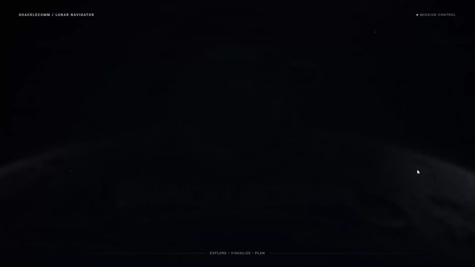

# ShackleComm

**A visual lunar landing-site analysis and communication-planning tool**  
**NASA Space Apps Challenge 2026 — [Lunar Landing Site Navigator](https://www.spaceappschallenge.org/2026/challenges/lunar-landing-site-navigator/)**



ShackleComm is an interactive web application for exploring the lighting and communication conditions at candidate lunar landing sites, particularly near the Moon's south pole. It brings site selection, time-dependent Sun and Earth visibility, and illustrative lunar relay coverage into a single, accessible interface.

The project responds to a central problem in lunar mission planning: a site suitable for science may be difficult to illuminate or contact from Earth, and changing a launch date may substantially change those conditions. ShackleComm makes these trade-offs visible so that students, educators, researchers, and interested members of the public can rapidly compare scenarios.

> **Scientific scope:** ShackleComm is an educational and preliminary analysis prototype, not an operational NASA planning system. It uses authentic NASA reference spacecraft states and published orbital parameters where stated, but other calculations—especially lunar topography, lunar ephemerides, and long-term relay trajectories—remain approximations. Its outputs must not be used for flight operations or landing decisions without independent validation.

## Project objectives

The application is designed to:

1. Make the Sun's and Earth's positions relative to a lunar landing site's horizon understandable without requiring specialist ephemeris software.
2. Compare candidate locations and mission dates using consistent sunlight and communication indicators.
3. Reveal the operational differences between direct-to-Earth communication and satellite-assisted relay communication.
4. Provide an intuitive three-dimensional view alongside simpler two-dimensional maps, timelines, and telemetry.
5. Retain enough scientific context to show how the estimates are produced and where their accuracy is limited.

## Main features

### Landing-site exploration

- **Curated lunar locations:** 13 reference sites, including Shackleton Rim, Mons Mouton, Malapert Massif, Nobile Rim, other south-polar candidates, and selected historical landing locations.
- **Custom coordinates:** Enter a lunar latitude and longitude or select a position directly on the interactive map.
- **Site suggestions:** South-polar sites are sorted by their calculated availability over the selected time window.
- **Viability indicator:** Each site receives a score from 0 to 100, displayed along a continuous red–ochre–green color scale.
- **Location comparison:** Pin up to three locations and compare their estimated sunlight and communication conditions. Pin controls appear only when relevant.
- **Clear selection feedback:** The active location is highlighted on the Moon and in the site panels.

### Interactive visualization

- **3D Earth–Moon scene:** Explore the Moon, Earth, sunlight direction, selected landing sites, and satellite trajectories with interactive camera controls.
- **2D South Pole projection:** Inspect the polar region without the perspective of the 3D scene.
- **2D global lunar map:** Explore locations outside the polar region.
- **Orbital guides:** Display the Moon's approximate orbit around Earth and an illustrative Earth–Moon barycenter orbit around the Sun.
- **NASA relay spacecraft:** Follow five proposed LCRNS reference satellites, identified visually as `LCRNS-1` through `LCRNS-5`.
- **Communication links:** Show direct lunar-base-to-DSN connections and lunar-base-to-relay-to-DSN routes when the geometric conditions are satisfied.
- **Local horizon plot:** Compare the estimated 360-degree terrain horizon with the Sun, Earth, and visible relay satellites.
- **Presentation controls:** Toggle orbital guides, satellite trajectories, communication lines, and the camera focus.

### Time and mission-window exploration

- **Date selection:** Set the beginning of the analysis period and move it forward or backward in one-day increments.
- **Time windows:** Inspect periods of **7 days**, **14 days**, or approximately **29.53 days** (one synodic lunar month).
- **Continuous playback:** Move through the selected window using a time scrubber, Play/Pause, and selectable speeds of **0.25×, 0.5×, 1×, 2×, and 4×**. At 1×, one real second represents one simulated hour.
- **Availability timeline:** See estimated sunlight, total Earth connectivity, and relay connectivity over the chosen period.
- **Transition estimates:** Display approximate time remaining until a change in illumination or communication status.

### Lighting and communication telemetry

- **Sunlight:** Current illuminated/shadowed status, Sun elevation, local terrain-horizon angle, and estimated horizontal solar irradiance in W/m².
- **Earth connection:** Current end-to-end status, including whether contact is direct, through a relay, through both, or unavailable.
- **DSN network:** Individual geometric availability of NASA's Madrid, Goldstone, and Canberra complexes.
- **Relay status:** Satellites overhead, satellites with a complete route to a DSN complex, approximate altitude, and local elevation.
- **Window statistics:** Estimated sunlight availability, direct-to-Earth availability, relay coverage, and overlap between sunlight and at least one communication route.
- **Expandable technical information:** Collapsible telemetry sections and a methodology panel keep the default interface approachable.

### User experience

ShackleComm uses a responsive, minimal interface with retractable sidebars, compact instrument panels, contextual site actions, and a full-screen welcome screen. The project's visual identity and favicon are integrated into the interface. The lunar image loader provides a procedural display fallback when the external texture cannot be retrieved.

## Getting started

ShackleComm is a browser-based project. No account, backend, database, build system, or installation of application packages is required.

**Requirements:** A modern browser with WebGL support. An internet connection is recommended because the page loads Three.js, Tailwind CSS, Google Fonts, and the preferred lunar texture from external sources.

1. Download or clone the project.
2. Open `main.html` in a modern browser, or serve the project with a small local HTTP server.
3. Select **Start** on the welcome screen.
4. Choose a lunar site or enter custom coordinates.
5. Set a date and analysis duration, then explore sunlight and communication changes using the time controls.
6. Pin additional locations to compare their availability and Viability scores.

For reliable local development, run the following command from the project folder:

```bash
python -m http.server 8000
```

Then visit `http://localhost:8000/main.html`.

To publish the project, host `main.html` as a static web page. The separate website distribution also includes conventional favicon assets and a web manifest. The standalone HTML distribution embeds the logo and icon assets directly.

## Scientific methodology

The implementation is designed to explain geometric and orbital relationships rather than to provide flight-certified predictions. Unless otherwise noted, simulation dates are handled in UTC, angular values are expressed in degrees in the interface, and physical distances in line-of-sight calculations are expressed in kilometers.

### 1. Solar and Earth positions

The function `getEphemeris()` uses an analytical approximation of the lunar synodic, sidereal, anomalistic, and draconic cycles. It estimates the subsolar and sub-Earth directions on the Moon, including simplified lunar libration (approximately ±7.6° in longitude and ±6.68° in latitude).

For a selected lunar observer, `getAzEl()` converts a target direction into local **azimuth** and **elevation**. Azimuth describes the direction around the horizon; elevation describes the angle above or below it. These values are compared with the local modeled terrain horizon.

These are **locally computed approximations**, not live queries to [NASA/JPL Horizons](https://ssd.jpl.nasa.gov/horizons/). The implementation does not reproduce a full integrated lunar ephemeris.

### 2. Local terrain and the horizon

The Moon has no substantial atmosphere to produce terrestrial-style atmospheric refraction. Visibility is primarily controlled by geometric position, lunar curvature, and the surrounding terrain.

ShackleComm currently generates an **illustrative synthetic elevation field** around known lunar features. `computeHorizonProfile()` samples the modeled terrain in **72 azimuth sectors**, spaced **5°** apart, at distances of **1.5, 3, 6, 12, 24, 45, and 80 km**. For each direction, it estimates the maximum apparent terrain elevation, including an approximate correction for the Moon's curvature:

```text
horizon_angle ≈ atan2(terrain_elevation - observer_elevation, distance)
                - distance / (2 × lunar_radius)
```

The Moon's reference radius is **1,737.4 km**. Horizon values between sampled azimuths are interpolated.

**Important:** The terrain model is not a downloaded NASA LOLA digital elevation model. The NASA lunar imagery used for surface appearance is a visual texture, not the source of the numerical terrain profile. Therefore, computed shadow boundaries and local horizon angles are illustrative and can be inaccurate for real landing sites.

### 3. Illumination and solar irradiance

A site is considered sunlit when the calculated solar elevation exceeds the modeled terrain-horizon elevation in the Sun's direction:

```text
sunlit = (solar_elevation > terrain_horizon_at_solar_azimuth)
```

For an illuminated **horizontal surface**, the ideal direct irradiance is estimated as:

```text
irradiance (W/m²) = 1361 × max(0, sin(solar_elevation))
```

If the Sun is hidden behind the modeled terrain, irradiance is set to zero. The value **1,361 W/m²** is the approximate mean solar irradiance normal to incident sunlight near 1 AU.

This quantity is **incident irradiance, not actual electrical power**. The present calculation does not determine solar-panel orientation, array efficiency, temperature, dust effects, local slope, changing Sun–Moon distance, penumbral illumination, or eclipse effects.

### 4. Direct-to-Earth communication

Direct-to-Earth (DTE) means that the lunar base can communicate with an Earth ground station **without a satellite relay**.

The application uses representative coordinates for the three NASA Deep Space Network complexes:

| DSN complex | Latitude | Longitude |
| --- | ---: | ---: |
| Madrid, Spain | 40.42917° N | 4.24972° W |
| Goldstone, California, USA | 35.28139° N | 116.77889° W |
| Canberra, Australia | 35.40167° S | 148.98222° E |

The DSN positions are fixed to Earth and rotate with the planet. `getEarthDsnGeometry()` estimates the Moon's right ascension and declination and the Greenwich sidereal angle. For a station of latitude `φ`, lunar declination `δ`, and local hour angle `H`, the Moon's elevation is found from:

```text
sin(elevation) = sin(φ) sin(δ) + cos(φ) cos(δ) cos(H)
```

A direct link is considered geometrically available only when:

1. Earth clears the selected lunar site's modeled terrain horizon; and
2. The Moon is above the receiving DSN station's ideal geometric horizon (elevation greater than 0°).

These tests indicate potential **geometric visibility**, not antenna availability, weather suitability, a verified radio link budget, or an operationally scheduled DSN pass.

### 5. NASA LCRNS relay constellation

ShackleComm uses **only NASA's five proposed LCRNS Reference Constellation 3.1 spacecraft**, designated **SV-1 to SV-5** in the NASA source and shown as **LCRNS-1 to LCRNS-5** in the visualization. No Chinese relay spacecraft are included. The curated *landing sites*, however, may include historical missions from other countries for geographical comparison.

NASA's reference initial states are given for **2027-03-01 00:00:00 UTC**, using Moon-centered ICRF position vectors in kilometers and velocity vectors in kilometers per second. Keplerian metadata are also shown in the interface, but their reference frame is different: NASA Table 1 uses the Moon-centered Principal Axis frame, while Table 2 uses ICRF.

| Satellite | Reference semi-major axis (km) | Eccentricity | Reference inclination |
| --- | ---: | ---: | ---: |
| SV-1 | 11,315.937 | 0.691982 | 59.373° |
| SV-2 | 11,317.949 | 0.691982 | 58.952° |
| SV-3 | 11,305.414 | 0.691982 | 52.733° |
| SV-4 | 11,326.302 | 0.691982 | 52.513° |
| SV-5 | 11,307.883 | 0.691982 | 56.310° |

For responsive browser playback, `getReferenceTwoBodyOrbit()` derives a **two-body osculating ellipse** directly from each published Cartesian position and velocity. `propagateRelaySatellite()` advances that orbit through Kepler's equation:

```text
M = E - e sin(E)
mean_motion = sqrt(lunar_gravitational_parameter / semi_major_axis³)
```

The gravitational parameter used is **4,902.800066 km³/s²**. An inertial-to-lunar-body transformation is applied before evaluating visibility from a landing site.

A satellite is **overhead** when its elevation clears both the modeled local terrain horizon and the application's **assumed 5° lunar terminal mask**. It is **linked** only when it is overhead **and** a direct satellite-to-DSN path exists without Earth or Moon occultation and with the satellite above a DSN station's geometric horizon.

The full communication condition is:

```text
Earth connection = direct base-to-DSN route
                   OR
                   (base-to-satellite route AND satellite-to-DSN route)
```

The five spacecraft are **NASA government reference trajectories**, not live tracked or confirmed deployed satellites. The assumed 5° lunar terminal mask is an application setting, not a constraint taken from LCRNS Reference Constellation 3.1.

NASA's recommended high-fidelity propagation uses the **DE421 planetary ephemeris**, **GRGM-900c lunar gravity (25×25)**, third-body perturbations, and solar radiation pressure. ShackleComm **does not implement that full dynamical model**. Relay positions away from the reference epoch are approximate and can diverge from a high-fidelity trajectory.

### 6. Time-window statistics and Viability

`analyzeTimeframe()` samples the selected period at **120 intervals** for the active site; cached site rankings use **72 intervals** per site. For each interval, the application checks whether sunlight, a direct DSN link, a complete relay connection, or any Earth communication route is available.

A percentage is estimated as:

```text
availability (%) = 100 × available_sample_intervals / total_sample_intervals
available_hours   = (availability / 100) × window_duration_hours
```

The **Sun + Comms Overlap** measures intervals where the site is illuminated and at least one complete Earth connection exists.

**Viability** is a deliberately simple comparison index:

```text
Viability = round(0.55 × sunlight_availability_%
                + 0.45 × any_Earth_connection_availability_%)
```

The badge transitions from red at low values, through ochre at intermediate values, to green at high values. **Viability is a relative visualization metric, not a NASA-certified site suitability or mission safety score.** It does not incorporate surface slope, landing hazards, thermal limits, science objectives, hardware margins, or power-storage capacity.

The timeline and transition readouts are **sampled estimates**. They are not high-precision sunrise, sunset, or link-acquisition event solutions.

### 7. Earth, Moon, and orbital guides

The Moon's displayed Earth-centered trajectory uses a simplified ellipse with mean semi-major axis **384,400 km**, eccentricity **0.0549**, and inclination **5.145°**. The Earth–Sun guide uses the **Earth–Moon barycenter** orbital elements and their time rates from [JPL's approximate planetary position tables](https://ssd.jpl.nasa.gov/planets/approx_pos.html), including the reference eccentricity **0.01671123**.

The 3D scene intentionally compresses astronomical distances and uses different visual scales for planets and spacecraft so they remain legible. These orbit lines are **educational guides**, not to-scale trajectories or substitutes for JPL Horizons.

## Data provenance and references

The distinction between **data used in the application** and **resources provided for independent verification or future improvements** is central to interpreting its results.

| Source | How ShackleComm uses it |
| --- | --- |
| [NASA Space Apps Challenge — Lunar Landing Site Navigator](https://www.spaceappschallenge.org/2026/challenges/lunar-landing-site-navigator/) | Challenge goals, target users, and requested site/date/visibility comparison workflow. |
| [NASA LCRNS Reference Constellation 3.1 (Ryden and Volle)](https://www.nasa.gov/wp-content/uploads/2025/08/nasa-lunar-communications-relay-and-navigation-systems-lcrns-reference-constellation-3-1.pdf) | Five proposed spacecraft, reference epoch, initial position/velocity vectors, and orbital metadata. |
| [NASA Deep Space Network](https://www.nasa.gov/communicating-with-missions/dsn/) | Reference for the three DSN complexes; the application models representative geographical centers and geometric visibility. |
| [NASA/JPL — Approximate Positions of the Planets](https://ssd.jpl.nasa.gov/planets/approx_pos.html) | Earth–Moon barycenter orbital parameters for the illustrative Earth–Sun guide. |
| [NASA Scientific Visualization Studio — CGI Moon Kit](https://svs.gsfc.nasa.gov/4720/) | Preferred LRO-derived lunar surface texture (`lroc_color_2k.jpg`); visual rendering only. |
| [NASA/JPL Horizons](https://ssd.jpl.nasa.gov/horizons/) | **Verification reference only**; the application does not currently request Horizons ephemerides. |
| [NASA LRO data products and QuickMap](https://science.nasa.gov/mission/lro/data-products/) | **Verification and future terrain-integration reference only**; no numerical LOLA terrain grid is currently loaded. |

The optional lunar texture has an online fallback image and a procedural offline fallback. External texture availability should not be interpreted as evidence of scientific terrain accuracy.

## Known limitations and intended use

- **Not mission-grade:** No flight certification or official NASA endorsement is implied.
- **Approximate Sun/Moon ephemerides:** Analytical cycles and simplified libration do not reproduce integrated JPL trajectory solutions.
- **Synthetic horizon:** Terrain profiles are generated procedurally, not extracted from measured LOLA DEM tiles; local shadows and polar visibility can be substantially wrong.
- **Approximate spacecraft propagation:** Authentic NASA initial states are propagated by a two-body solver, without the non-spherical lunar gravity and perturbations specified for the LCRNS design.
- **Geometric connections only:** DSN availability does not account for antenna schedules, hardware pointing restrictions, station terrain masks, link budget, atmospheric conditions, or antenna-to-antenna handover constraints.
- **Idealized solar model:** Surface irradiance does not equal solar-array electrical output; eclipses, panel orientation, actual slopes, and thermal effects are not modeled.
- **Discrete window estimates:** Reported percentages and event times depend on sampling density.
- **Illustrative display scale:** Planetary sizes and separations are deliberately distorted to support learning and visualization.

These constraints are deliberate for a lightweight, accessible demonstration. For engineering use, the next steps would be measured LOLA horizon profiles, integrated ephemerides, full-fidelity satellite propagation, and explicit communications and power-system models.

## Technology and implementation

- **HTML5, CSS, and JavaScript** in a browser-based application.
- **Three.js r128** with OrbitControls for the interactive 3D environment.
- **Canvas 2D** for lunar projections, the time-window strip, and the horizon plot.
- **Tailwind CSS** loaded from its CDN, complemented by a custom basalt-and-mineral design system.
- **Roboto** typography, SVG interface icons, responsive panels, and a branded welcome screen.
- **No backend or database:** Computations are performed locally in the browser, although some libraries and visual assets are loaded remotely.

The computational code includes site-window caching and separate update paths for continuously displayed positions and sampled window statistics. Lightweight procedural satellite shapes are retained to avoid depending on unverified external 3D models.

## Project status

ShackleComm is an independently developed prototype inspired by the **NASA Space Apps Challenge 2026 — Lunar Landing Site Navigator** challenge. It is intended to help communicate the practical relationships among lunar geography, sunlight, orbital motion, and communication access, while making the calculation assumptions visible to its users.

NASA, JPL, and other named organizations are credited for the referenced scientific materials. Their inclusion does not imply sponsorship, partnership, approval, or endorsement of this project.
